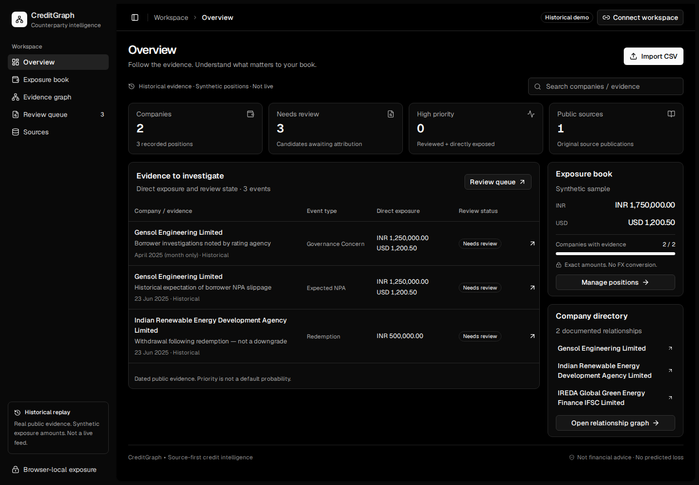
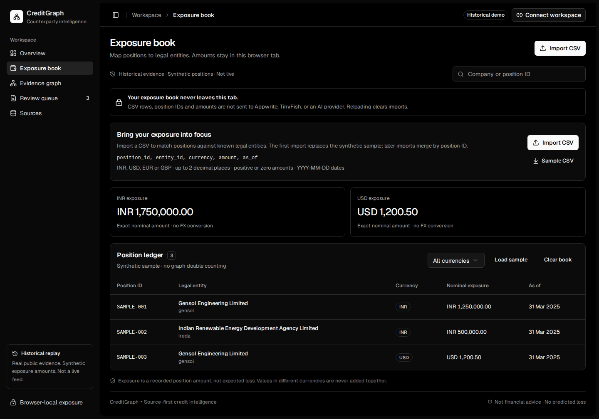
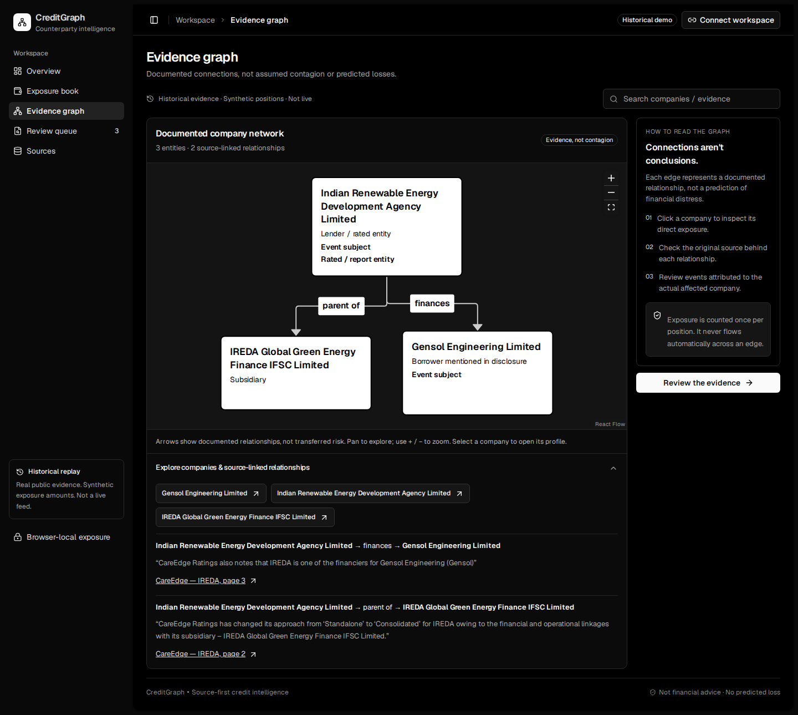
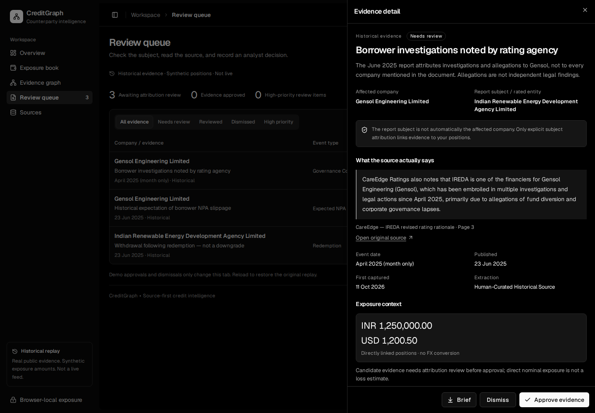

# CreditGraph

**Understand which public company disclosures matter to your exposure book.**

CreditGraph is a counterparty-review prototype for credit analysts, lenders and treasury teams. It brings source evidence, company relationships and portfolio positions into one workspace—so an analyst can check the original disclosure, identify the company involved and record a review decision.



## What is it useful for?

- **Prioritize reviews:** see public events alongside your direct exposure to the company involved.
- **Check the evidence:** read the exact quote, open its source and distinguish the borrower, lender and publisher.
- **Understand relationships:** explore a company graph with cited links, without treating every connected company as equally at risk.
- **Keep a review trail:** approve or dismiss evidence, add a note and download a brief with the citation and linked exposure.

**Example:** a disclosure mentions a borrower under investigation. CreditGraph helps you inspect that claim against your positions in the borrower, rather than automatically attributing it to the lender that appears in the same document.

## Screenshots

These are real captures of the bundled demo: historical public evidence with **synthetic positions**, not customer holdings or a live monitoring feed.

### Exposure book
Import a CSV and see exact amounts grouped by currency. Positions stay in browser memory; there is no FX conversion.



### Evidence graph
Explore documented relationships and open a company's profile. A relationship is context—not an automatic transfer of risk or exposure.



### Evidence review
Inspect the quotation and dates, follow the source, record a decision and export a brief.



## Try it locally

Requires **Node.js 22.12+** and npm. No account, API key, Python installation or environment file is needed for the demo.

```sh
git clone https://github.com/Bhaskar0825/creditgraph.git
cd creditgraph
npm ci
npm run dev
```

Open the address printed by Vite. Start in **Exposure book**, inspect a company in **Evidence graph**, then open **Review queue** to review an event and download its **Brief**. Reloading resets imported positions and demo decisions.

## Privacy and scope

- Imported positions are not uploaded by the portfolio workflow. **Exported briefs do include linked exposure amounts**; check them before sharing.
- The demo replays historical disclosures. Queue priority is a review rule, **not a credit rating, default prediction or investment recommendation**. Approval is an evidence decision, not proof of misconduct.
- Optional Appwrite cloud mode stores evidence, notes and reviews. Public-source collection and AI-assisted extraction require separate server configuration; they are not running in the no-key demo.

## Build and documentation

Built with **React + Vite**, **shadcn/ui + Radix**, **React Flow + Dagre** and local **Geist** fonts. The optional backend is a Python Appwrite Function.

```sh
npm test
npm run build
```

- [Setup guide, CSV format, privacy details and troubleshooting](docs/setup.md)
- [Appwrite Function deployment and API](functions/creditgraph/README.md)
- [Open-source interface credits](THIRD_PARTY_NOTICES.md)
